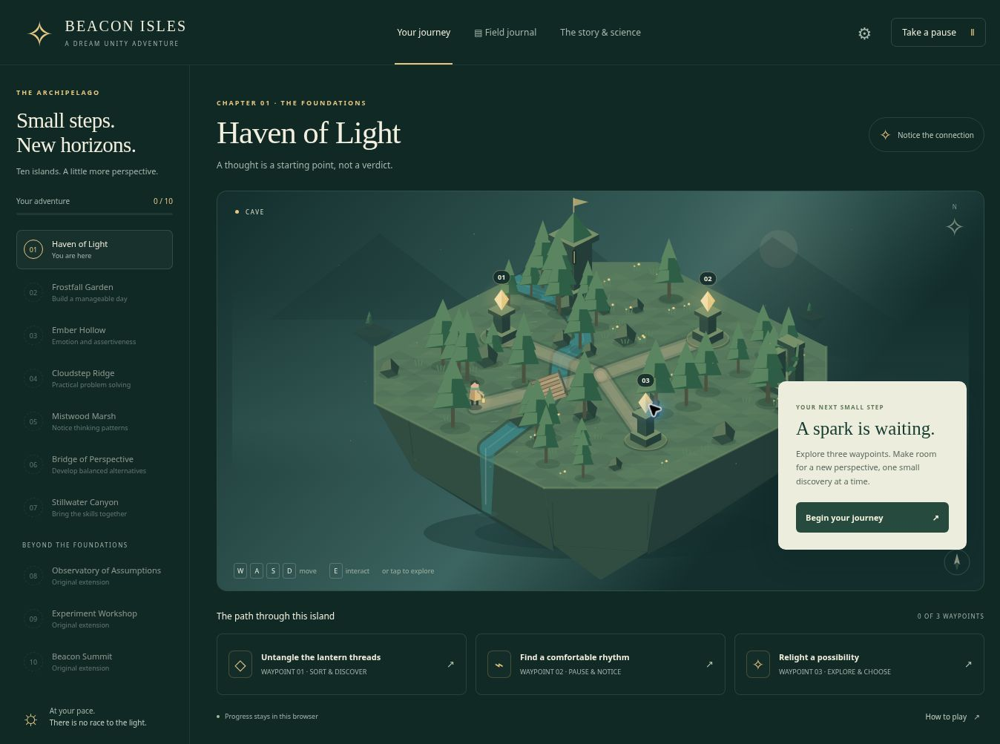

# Beacon Isles

An original, playable ten-chapter CBT skills adventure by Dream Unity, developed in the **SPARX** repository.

**[Play Beacon Isles](https://sparx-beacon-isles.mike-entrepreneur202.chatgpt.site)** · **[Research and provenance](docs/RESEARCH.md)**

The hosted version uses owner-private Sites access. The source repository is public.



Explore ten procedural isometric islands, meet their challenges, collect three sparks per chapter and light each beacon. Every chapter includes an optional practical reflection. There is no countdown, death, score penalty or requirement to disclose personal experiences.

## What's playable

| Chapter | Island | Focus |
| --- | --- | --- |
| 1 | Haven of Light | Events, interpretations, feelings and actions; optional gentle breathing |
| 2 | Frostfall Garden | Manageable activities, relaxation and communication |
| 3 | Ember Hollow | Emotions, assertiveness, listening and boundaries |
| 4 | Cloudstep Ridge | Practical problem solving |
| 5 | Mistwood Marsh | Recognising unhelpful thinking patterns |
| 6 | Bridge of Perspective | Evidence and balanced alternatives |
| 7 | Stillwater Canyon | Integration, setbacks and support |
| 8 | Observatory of Assumptions | Observations, interpretations and underlying rules |
| 9 | Experiment Workshop | Small, safe behavioural experiments |
| 10 | Beacon Summit | Applying skills to unfamiliar situations |

Thirty activities use categorisation, ordered steps, scenario choices, planning choices and an optional paced pause with an equivalent observation alternative. Guided retries explain the reasoning. Notes and chapter plans are optional. Revisiting completed chapters remains available.

The first seven chapters follow **published skill topics** from SPARX. The last three are original extensions. All code, artwork, characters, scenarios and dialogue are newly created.

## Controls

- Move with **WASD / arrow keys**, click-to-walk, or the mobile directional buttons.
- Interact with **E / Space** near a beacon, or click a beacon to walk to it.
- The three waypoint cards provide the same activities without canvas navigation.
- Use **Escape** to close dialogs. Take a pause at any point.
- Ambient motion is off by default; device reduced-motion preferences take priority.

## Run locally

No installation, build step, runtime dependencies, API keys or backend are required. Serve `dist/` using an ordinary static HTTP server:

```sh
python3 -m http.server 8080 --directory dist
```

Then open `http://localhost:8080`. Opening `index.html` directly as `file://` is not supported because the game uses JavaScript modules.

With Node.js 20 or newer:

```sh
npm test
npm run check
```

## Project structure

- `dist/index.html` — accessible page and dialog shell.
- `dist/style.css` — responsive interface and reduced-motion presentation.
- `dist/world.js` — original procedural canvas scenery, ten biomes and navigation.
- `dist/content.js` — ten chapters, thirty exercises and source references.
- `dist/app.js` — activities, journal, import/export, settings and chapter flow.
- `dist/state.js` — bounded persistence and progression rules.
- `tests/` — full-journey state, malformed storage/imports, content reachability and all thirty world paths.
- `docs/RESEARCH.md` — primary-source review, comparative evidence and design rationale.
- `docs/VERIFICATION.md` — verification scope and limitations.
- `.openai/hosting.json` — static hosting configuration.

## Research and scope

This is an **independent educational prototype**, not the official SPARX programme, an authorised release, a clinical assessment or a validated treatment. It is not affiliated with the University of Auckland or Metia Interactive. The SPARX name identifies the research precedent; official source code, art, audio and text are not redistributed.

The research review includes the original 2012 treatment trial, subsequent prevention studies, the 2025 Future Proofing null trial and 2025 national implementation findings. Their results apply to the studied programmes and populations, not automatically to Beacon Isles. Finishing a chapter records game activity; it does not measure recovery, intelligence or demonstrated everyday psychological competence.

The new activities are shorter than original SPARX sessions and do not reproduce its therapeutic dose. The game provides fictional practice situations, not personalised therapy or crisis monitoring. Clinical/content review, participant co-design and outcome evaluation remain future work.

## Privacy

The app makes no API requests and includes no analytics or advertising. Game progress and optional notes are stored in browser `localStorage`. They are not encrypted and may be readable by other people using the same browser profile. Hosting infrastructure may still maintain normal access logs independently of game data.

Progress does not automatically sync across devices. Settings includes JSON export/import and a confirmed reset. Exports include optional notes; store them accordingly. If storage is unavailable or full, play continues in memory and the interface advises exporting. Clearing browser data can erase local progress.

## Hosting

`dist/` can be served by an ordinary static host. This repository includes a Sites manifest for its current deployment. When deploying a separate copy elsewhere, remove or replace the existing Site identity rather than attempting to publish to this project's Site.
